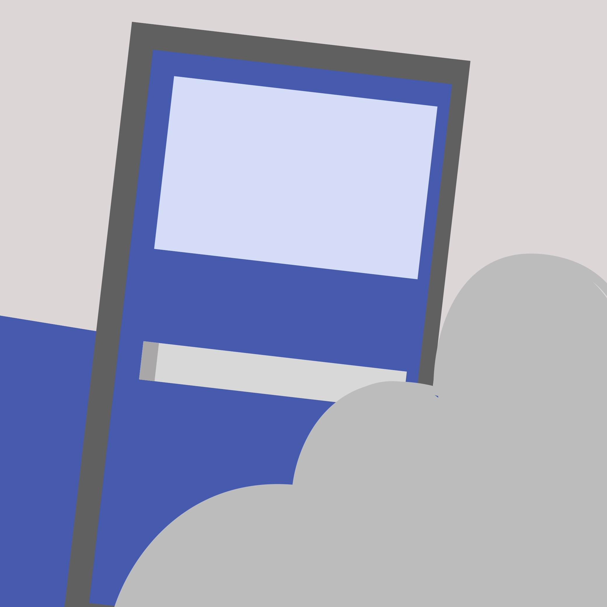

# CrowdClear



CrowdClear is an evacuation training game for venue staff. Guide 60 people through a stadium lobby, handle blocked exits, and reassure panicking guests. Play in a laptop browser or use the experimental WebXR headset view.

The crowd and calmness cues are simplified game mechanics. They do not predict real emergencies or provide a medical assessment.

## What the program does

- **Practice.** Learn to open an exit and send people there without a timer.
- **Run a drill.** Manage a 60-second evacuation with two or three blockages, scattered starting positions, varied walking speeds, and panicking guests.
- **Respond.** Clear a blockage for four seconds, reopen the door, redirect people, and reassure guests. Color labels, exit signs, smoke, fire, and audio help show what is happening.
- **Review.** See people out, time left, guests calmed, guests still panicking, score, longest queue, and a timed action log. Compare the current drill with your locally stored best run and play them side by side.
- **Save and share.** With Postgres configured, the server checks the recorded decisions by replaying them before saving. Share the resulting page address to reopen the drill.
- **Add webcam sensing.** The optional Presage helper supplies breathing and other authorized webcam metrics for the game's calmness review. The game works without the helper.

## Start everything locally

Use **Node.js 24**, the version pinned in [.node-version](.node-version), and npm. Express serves the frontend and API together, so there is no separate frontend build or server.

### 1. Install the game

```sh
git clone https://github.com/lyanisbarreto-mercado/crowdclear.git
cd crowdclear
npm install
```

### 2. Set up optional services

To use Presage, install its separate native SDK once:

```sh
npm --prefix sensor install
```

On **Windows ARM / Snapdragon**, use the x64 setup below instead of that sensor install command.

Create `.env.local` in the project root. Add only the services you want:

```dotenv
# Optional: webcam sensing
PRESAGE_API_KEY=your_presage_api_key

# Optional: save and reopen drills with Neon or another Postgres database
DATABASE_URL=your_postgres_connection_string

# Optional: change the local port
PORT=3000
```

Leave unused settings out. Keep `.env.local` private; it is gitignored. Presage requires a valid SmartSpectra API key and access to the laptop camera. Without `DATABASE_URL`, drills still run but results show **Not saved**.

### 3. Run one command

```sh
npm run dev
```

Open **http://localhost:3000**, or the address printed for your chosen `PORT`.

This command loads `.env` and `.env.local`, starts the game server, waits for its health endpoint, and starts Presage when its key, SDK, and Node runtime are available. Missing sensor setup produces a message and leaves the game running. **Ctrl+C** stops both processes. A sensor failure leaves the game available; a game-server failure stops the launcher and sensor.

The launcher does not start a database service. Neon runs separately; `DATABASE_URL` connects the game to it. Existing artwork and audio are bundled, so playing requires no Higgsfield or ElevenLabs key.

## How to play

1. Click **Start practice**. Click the middle door to **Open Exit B**, then click it again to **Send people to B**.
2. Click **Start timed drill**. The first blockage appears after 10 to 20 seconds; more can follow.
3. Click a red-outlined blockage to **Clear** it. Wait four seconds, then click the door to **Open** it. Other open exits remain available during clearing.
4. Click an open door to **Send people** there. Wait for the five-second redirect cooldown before another direction.
5. On a laptop, use **Reassure** when guests panic. In VR, use microphone reassurance when supported and allow microphone access. The on-screen instructions show the available control.
6. Read the results and action log. After another run, use **Play side by side** to compare with your best run. Move **Jump to time** to inspect a point in the replay. The wireframe crowd is the best run; the solid crowd is the current run.
7. If the result says **Saved**, copy the page address to share or reload it. **Restart practice** resets the tutorial; **Try another drill** starts a fresh timed run.

Best-run comparison is stored in that browser. Shared run links require the database. The current simulation is version 9; older records stay stored, but the player rejects replay under different rules.

## Presage on Windows ARM

SmartSpectra's Windows native runtime needs **x64 Node**, including on Snapdragon computers. The game server can still use the normal ARM Node installation.

Download a Windows x64 Node.js 24 ZIP from [Node.js downloads](https://nodejs.org/en/download). Extract its contents so this file exists:

```text
tools/node-win-x64/node.exe
```

Install the sensor SDK with that x64 runtime. From the project root in PowerShell:

```powershell
& .\tools\node-win-x64\node.exe .\tools\node-win-x64\node_modules\npm\bin\npm-cli.js --prefix sensor install
npm run dev
```

The launcher and `npm run sensor` select that runtime automatically. If you installed x64 Node elsewhere, set `PRESAGE_NODE_PATH` to its executable in `.env.local`.

Face the webcam with your face and chest visible, use steady lighting, and allow about 30 seconds for usable readings. The emulated runtime can produce readings more slowly. A headset hides the face, so webcam sensing is intended for laptop sessions.

## VR and audio

Use **Enter VR** in a browser that supports immersive WebXR. A deployed headset session requires HTTPS; supported local development can also use browser tooling or a headset tunnel. The [Immersive Web Emulator](https://github.com/meta-quest/immersive-web-emulator) can test headset and controller behavior on a desktop.

Point at doors to open or redirect. Select a blocked door twice to start clearing, wait four seconds, then reopen it. Headset panels show instructions, cooldowns, results, and replay controls. PA speech is silent in the headset view; captions remain available. Microphone features depend on browser support and permission. Physical-headset compatibility and comfort still need a device check.

On a laptop, **Sound: on/off** controls prerecorded announcements, alarm, and crowd ambience. Missing voice clips stay silent; a missing alarm falls back to synthesized beeps.

## Commands

| Command | What it starts |
| --- | --- |
| `npm run dev` | Frontend/API and optional Presage together; loads local environment files |
| `npm start` | Game server only; suitable for hosting |
| `npm run sensor` | Presage only; loads local environment files |
| `npm test` | Simulation, UI, API, persistence, sensor, asset, and launcher tests |
| `npm run audio` | Optional audio regeneration using ElevenLabs credentials |

Audio regeneration is separate from playing. Set `ELEVENLABS_API_KEY` or `ELEVEN_API_KEY` in a private environment file before running it. Existing clips are kept; `npm run audio -- --force` replaces them. `ELEVENLABS_VOICE_ID` and `ELEVENLABS_MODEL_ID` can override the generator's defaults.

## Configuration

| Setting | Purpose |
| --- | --- |
| `PORT` | Local game port; defaults to `3000` |
| `DATABASE_URL` | Postgres connection for saving; optional |
| `PRESAGE_API_KEY` | SmartSpectra key; `SMARTSPECTRA_API_KEY` is also accepted |
| `PRESAGE_NODE_PATH` | Optional Node executable for the native helper |
| `BREATHING_URL` | Optional full sensor upload URL; defaults to the local game API |
| `PRESAGE_ENDPOINT` | Alternate name for the sensor upload URL |
| `ALLOW_REMOTE_BREATHING` | Server opt-in for remote demo sensing; defaults to off |
| `BREATHING_TOKEN` | Optional token protecting remote sensor uploads |

By default, sensor reads and writes require localhost. Readings stay in server memory and are not included in saved drills.

For a **shared deployed sensor demo**, set `ALLOW_REMOTE_BREATHING=1` on the server and use the same `BREATHING_TOKEN` on the server and laptop helper. Set the helper's `BREATHING_URL` to `https://YOUR-APP.onrender.com/api/breathing`, then run `npm run sensor` on the laptop. Remote mode shares one current reading with site visitors; the token protects uploads, not reads. Prefer local mode for private sessions.

## Troubleshooting

- **Presage skipped.** Add a valid key, install the sensor SDK, and check the x64 Node setup on Windows ARM. The game remains playable.
- **No webcam readings.** Read the helper's terminal messages, check camera access and lighting, and wait for a confident sample. A configured remote upload URL will send readings to that server instead of the local HUD.
- **Not saved.** Configure a reachable `DATABASE_URL`. Database setup errors appear in the server terminal; the drill itself still runs.
- **Port already in use.** Stop the existing server or set a different `PORT` in `.env.local`.
- **No Enter VR button or microphone response.** Use a compatible browser with the required permissions and HTTPS for a deployed headset session. Laptop controls remain available.

## Stack and deployment

- **A-Frame 1.8.0 / Three.js / WebXR** render the scene and immersive controls.
- **Plain JavaScript** runs the deterministic simulation and shared laptop/headset UI.
- **Node.js / Express 5** serve the frontend and validate recorded runs.
- **Neon Postgres** stores scenario, version, decisions, and results when configured.
- **Presage SmartSpectra** supplies optional local webcam metrics.
- **ElevenLabs** generated the bundled voice and sound effects.
- **Higgsfield** generated concourse artwork. Characters use Kenney assets; see [asset provenance](public/textures/concourse/README.md).

For Render, use `npm ci` as the build command, `npm start` as the start command, and set `DATABASE_URL` in the service environment. The server creates or updates its table from [schema.sql](schema.sql). CI and hosting use [.node-version](.node-version). Keep webcam sensing on the laptop rather than the hosting server.

See [PLAN.md](PLAN.md) for development evidence, [Devpost copy](docs/devpost-about.md) for the project story, and [agent skills](.agents/skills/README.md) for the local development kit.
